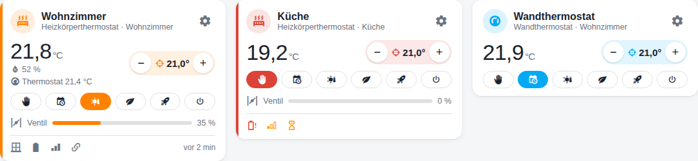
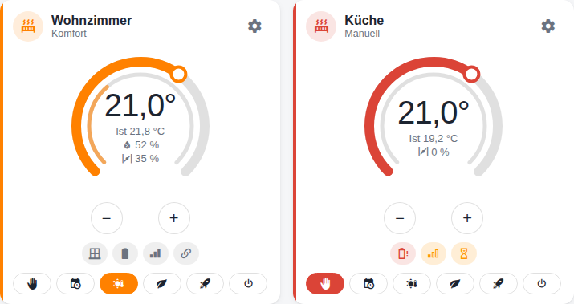
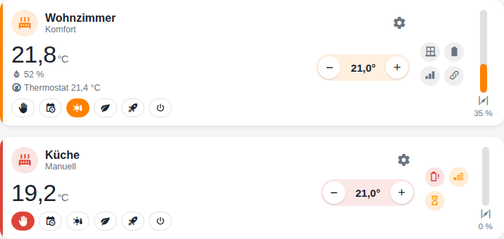
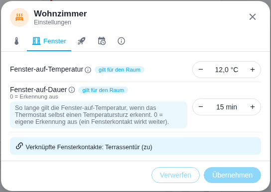
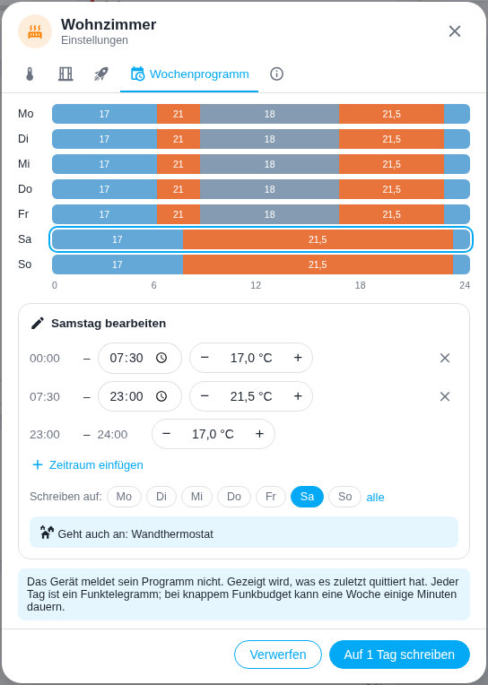

# eQ-3 MAX! Thermostat Card

[English](README.md) · **Deutsch**

Eine Lovelace-Karte für MAX!-Heizkörper- und Wandthermostate der Integration
[eq3_max](https://github.com/ma-schmitz/eq3_max) (braucht **eq3_max 0.8.0 oder neuer**).



| Ring – zum Ziehen | Kachel |
|---|---|
|  |  |

| Einstellungen im Pop-up | Wochenprogramm |
|---|---|
|  |  |

- Ist- und Solltemperatur, −/+ und die Modi Manuell, Auto, Komfort, Eco, Boost, Aus
- Ventilstellung, Batterie, Funkempfang, verknüpftes Fenster, Verknüpfungen, Bediensperre und ausstehende Befehle als Symbole
- Einstellungen im Pop-up, ohne das Dashboard zu verlassen: Temperaturen, Fenster, Boost & Ventil
  (Wandthermostat: Boost & Anzeige Soll/Ist), **Wochenprogramm** und Geräteinfo
- Drei Layouts: `kompakt` (Standard), `ring` (Sollwert durch Ziehen oder Tippen am Ring), `kachel`
- Optional ein externer Temperatursensor, der den Wert des Thermostats ersetzt, und ein Feuchtesensor
- Klick auf Ist-Temperatur, Luftfeuchte oder Ventil öffnet den Verlauf von Home Assistant
- Jede Einstellung per Mouseover und ⓘ erklärt
- Deutsch und Englisch, folgt Sprache und Theme von Home Assistant

## Installation

HACS → ⋮ → *Benutzerdefinierte Repositories* → `https://github.com/ma-schmitz/eq3-max-thermostat-card`,
Kategorie *Dashboard* → installieren. Oder `eq3-max-thermostat-card.js` nach `/config/www/` kopieren
und als Dashboard-Ressource (*JavaScript-Modul*) eintragen.

## Konfiguration

Karte im Dashboard-Editor hinzufügen („eQ-3 MAX! Thermostat“) oder in YAML:

```yaml
type: custom:eq3-max-thermostat-card
entity: climate.wohnzimmer
layout: kompakt      # kompakt | ring | kachel
name: Wohnzimmer     # optional
show_modes: true     # optional
temperature_sensor: sensor.wohnzimmer_temperatur  # optional, ersetzt den Wert des Thermostats
humidity_sensor: sensor.wohnzimmer_luftfeuchte    # optional
```

Ist der externe Temperatursensor nicht verfügbar, zeigt die Karte wieder den Wert des Thermostats.
Die Sensoren ändern nur die Anzeige; das Thermostat regelt weiter nach seinem eigenen Fühler.
Deshalb zeigt die Karte dessen Messwert klein darunter (Ring: als Tooltip) – eine große
Abweichung erklärt, warum ein Raum wärmer oder kälter wird als erwartet.

## Wer darf was

Temperatur und Modus sind für alle Benutzer frei. Geräteeinstellungen und Wochenprogramme
lassen sich in den Optionen von eq3_max für Benutzer ohne Admin-Rechte sperren („Benutzer
ohne Admin-Rechte dürfen Geräteeinstellungen / Wochenprogramme ändern“). Die Integration setzt
das durch; die Karte zeigt dann nur die Werte.

## Symbole

| Symbol | Bedeutung |
|---|---|
| Fenster zu / offen (orange) | verknüpfter Fensterkontakt oder die eigene Fenster-auf-Erkennung des Thermostats |
| Batterie / Batterie-Warnung (rot) | Batterie ok / schwach (MAX! meldet nur diese zwei Zustände) |
| Signal 3 / 2 / 1 (orange) / aus (rot) | > −70 dBm, −70…−85, < −85 dBm, Funkfehler |
| Kette | mit Wandthermostat oder anderen Geräten verknüpft |
| Schloss | Bediensperre am Gerät |
| Sanduhr | Befehl gesendet, noch nicht quittiert |

## Lizenz

MIT
