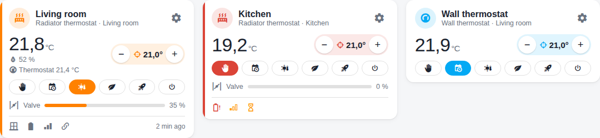
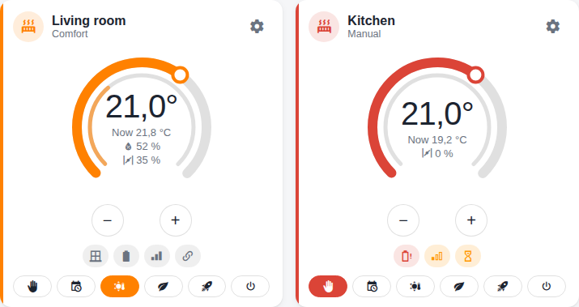
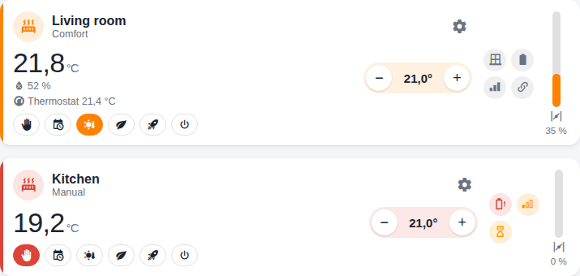
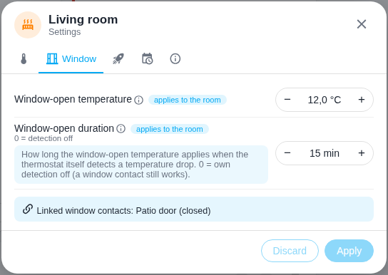
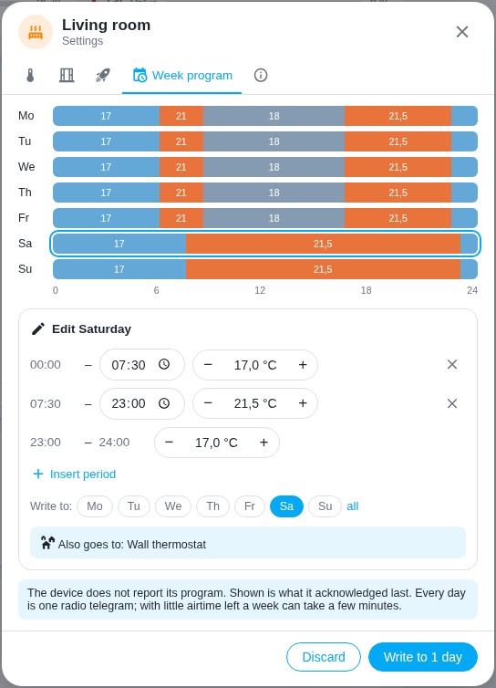

# eQ-3 MAX! Thermostat Card

**English** · [Deutsch](README.de.md)

A Lovelace card for eQ-3 MAX! radiator and wall thermostats of the
[eq3_max](https://github.com/ma-schmitz/eq3_max) integration (requires **eq3_max 0.8.0** and **Home Assistant 2026.8** or newer).



| Ring – drag to set | Tile |
|---|---|
|  |  |

| Settings pop-up | Week program |
|---|---|
|  |  |

- Current and target temperature, −/+ and the modes Manual, Auto, Comfort, Eco, Boost, Off
- Valve position, battery, radio reception, linked window, links, operation lock and pending commands as symbols
- Settings in a pop-up, without leaving the dashboard: temperatures, window, boost & valve
  (wall thermostat: boost & display set/current), **week program** and device info
- Three layouts: `kompakt` (default), `ring` (drag or tap the ring to set the target), `kachel` (tile)
- Optional external temperature sensor that replaces the thermostat's own reading, and an optional humidity sensor
- Click the current temperature, the humidity or the valve for Home Assistant's history graph
- Every setting explained on hover and with ⓘ
- German and English, follows the Home Assistant language and theme

## Installation

HACS → ⋮ → *Custom repositories* → `https://github.com/ma-schmitz/eq3-max-thermostat-card`,
category *Dashboard* → install. Or copy `eq3-max-thermostat-card.js` to `/config/www/` and add it
as a dashboard resource (*JavaScript module*).

## Configuration

Add the card in the dashboard editor ("eQ-3 MAX! Thermostat") or in YAML:

```yaml
type: custom:eq3-max-thermostat-card
entity: climate.living_room
layout: kompakt      # kompakt | ring | kachel
name: Living room    # optional
show_modes: true     # optional
temperature_sensor: sensor.living_room_temperature  # optional, replaces the thermostat's reading
humidity_sensor: sensor.living_room_humidity        # optional
```

If the external temperature sensor is unavailable, the card falls back to the thermostat's own reading.
The sensors only change what the card shows; the thermostat keeps regulating on its own sensor.
So the card also shows the thermostat's own reading small below (ring: as a tooltip) – a large
gap explains why a room gets warmer or colder than expected.

## Who may change what

Temperature and mode are open to every user. Device settings and week programs can be
locked for users without admin rights in the options of eq3_max ("Users without admin
rights may change device settings / week programs"). The integration enforces this; the
card then only shows the values.

## Symbols

| Symbol | Meaning |
|---|---|
| window closed / open (orange) | linked window contact, or the thermostat's own open-window detection |
| battery / battery alert (red) | battery ok / low (MAX! only reports these two) |
| signal 3 / 2 / 1 (orange) / off (red) | > −70 dBm, −70…−85, < −85 dBm, radio error |
| link | linked with a wall thermostat or other devices |
| lock | operation lock on the device |
| hourglass | command sent, not acknowledged yet |

## License

MIT
